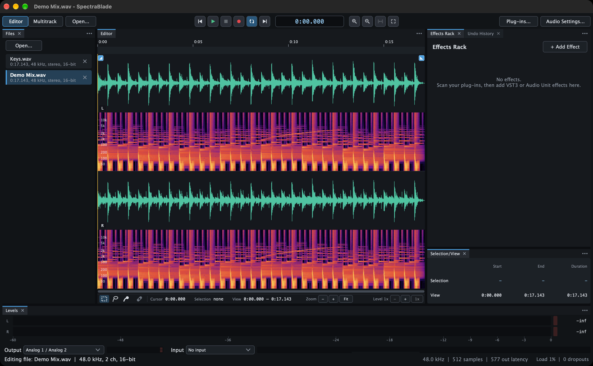

# SpectraBlade

A clean-room audio editor for macOS: waveform and spectral editing, repair and loudness tools, built-in effects, multitrack sessions with automation and mixdown, and VST3 and Audio Unit plug-ins. Built on JUCE 9.0.4.


**Status:** 0.9.5, an alpha for testing before 1.0. See the [changelog](CHANGELOG.md) for what each version holds and the [roadmap](ROADMAP.md) for what comes next.

SpectraBlade was called Waveloom, then briefly WaveDrill, until 31 October 2026. On first launch it copies the settings of whichever earlier version you ran (audio device, inputs and outputs, plug-in list), and it still opens `.wdrack` and `.wlrack` rack files.

## Features

- **Editing audio files:** waveform and spectrogram views; cut, copy, paste, paste mix and paste to fill; silence, insert and trim silence, crop, reverse, invert, swap, copy or silence one channel, mix to mono and make stereo; gain, normalize (each channel or each region on its own), fades with shapes, gain and pan ramps, balance and stereo width; markers and regions, with lists, CSV import and export, and saving regions or the pieces between markers as files; an undo history.
- **Repair and analysis:** spectral selection and attenuation, noise reduction, click and pop repair, Repair Selection, DC offset removal, a noise gate; finding clipping, silences and sounds; EBU R128 loudness with Match Loudness and true-peak limiting; stereo correlation; sample-rate conversion.
- **Effects:** parametric, graphic (10 and 31 bands) and single-band EQ, compressor, multiband compressor, de-esser, limiter, chorus, flanger, phaser, tremolo, echo, reverb and convolution reverb, each applied to the selection with a preview and presets, and most of them also live in the effects rack and on tracks; VST3 and Audio Unit plug-ins, each checked when it is scanned.
- **Recording:** from the cursor, or punched in over a selection with pre-roll and post-roll; loop recording into takes; several tracks at once; input monitoring through a track's effects; a metronome and count-in.
- **Multitrack sessions:** tracks, buses, sends, folders and groups; clip gain, fades, crossfades, stretching and pitch shifting; automation of volume, pan and effect parameters, drawn or written while playing; a tempo map with bars and beats and quantizing; a mixer; freezing, bouncing, mixdown and stems; recovery after a crash.
- **Getting around:** several files open at once with a Files panel; panels docked around the editor, tabbed or floating, kept in workspaces; a levels meter, a frequency analyzer and a phase meter of what plays; a transport bar whose tooltips show your keys, keyboard shortcuts you can search, change, export and import (with an Audition-style key set), recent files, and files opened from Finder.

## Screenshots




The audio in both was generated for the screenshots.

## Download and install

Builds are on the repository's [Releases](../../releases) page as `SpectraBlade-<version>.dmg`, with a `.sha256` beside each. They are universal (Apple silicon and Intel) and need macOS 13 or later.

Open `SpectraBlade-<version>.dmg` and drag SpectraBlade to Applications; the licence is beside it as `LICENSE.txt`. The app is signed ad hoc, not with a Developer ID, so macOS blocks it the first time: open it once, then choose Open Anyway under System Settings > Privacy & Security. After that it opens normally. macOS asks for microphone access the first time you choose a recording input.

Then choose Window > Plug-ins... and Scan for Plug-ins. The first scan of a large collection takes a while; it runs in the background, and the window shows how far it has got.

## Getting started

- **Open a file:** File > Open (Cmd-O), drop it on the window, or click one of the recent files listed in the empty editor. Tick Preview in the open panel to hear files as you select them.
- **Look at it:** View > Waveform (Cmd-1), Spectrogram (Cmd-2), or Waveform and Spectrogram (Cmd-3); in the last, drag the line between the two to size them.
- **Edit:** select by dragging (double-click selects the whole file), Option-drag in the spectrogram to select a band of frequencies, and use the Edit and Effects menus. Space plays the selection, or from the cursor.
- **Use plug-ins on a file:** add effects to the effects rack beside the editor (+ Add Effect, by format and maker), set them up with Edit while you listen, then Effects > Apply Effects Rack (Cmd-R) writes them into the selection or the whole file. Window > Effects Rack (Option-Cmd-E) hides or shows it.
- **Multitrack:** View > Multitrack Session (Cmd-4) switches to the session; each track's FX button holds its own effects.
- **Several files:** files you open join the ones already open. Window > Files lists them; click one to show it (each keeps its own selection, zoom and undo history), and Cmd-W closes the one showing. File > Next File and Previous File step through them.
- **Meters and analysis:** Window > Levels meters what goes to the outputs (click it to reset the peaks and clip lights); Window > Frequency Analysis and Phase Meter show its spectrum and its stereo image.
- **Panels and workspaces:** the effects rack, the selection, the files, the mixer, markers, clip lists, the meters and the rest are panels docked around the editor. Drag a panel's tab onto the edge of another panel to dock it there, onto its middle to make it a tab there, or out of the window to float it; drag the bars between panels to size them. Close a panel with its ×, and show it again from the Window menu. Window > Workspace switches between layouts (Classic, Editing, Multitrack, Analysis and your own), keeps each as you left it, saves the current one under a name, and puts one back as it was saved. Other windows open where you last left them.
- **Keys:** Window > Keyboard Shortcuts... lists every command's keys; change them, export and import them, or pick Key Sets... > Audition-Style Keys.

## Plug-ins

SpectraBlade hosts VST3 and Audio Unit (v2 and v3) effects. Window > Plug-ins... scans for them **out of process**: each one is loaded in a worker copy of the app, and one that crashes, or hangs longer than 60 s, is marked as not working while the editor keeps running.

- AU: `/Library/Audio/Plug-Ins/Components`, `~/Library/Audio/Plug-Ins/Components`, and AUv3 app extensions
- VST3: `/Library/Audio/Plug-Ins/VST3`, `~/Library/Audio/Plug-Ins/VST3`

VST2 is deliberately not supported: Steinberg no longer licenses the VST2 SDK.

## Building from source

You need Xcode (command-line tools) and CMake 3.22 or later.

```bash
cmake -S . -B build -DCMAKE_BUILD_TYPE=Release
cmake --build build -j 12
open build/SpectraBlade_artefacts/Release/SpectraBlade.app
```

CMake fetches JUCE 9.0.4 by itself. To use a local checkout instead, add `-DSPECTRABLADE_JUCE_DIR=/path/to/JUCE`.

## Packaging

```bash
Scripts/package.sh
```

This builds a universal Release app in `build-release/`, signs it ad hoc, runs the integration tests with that signed app as the plug-in scan worker, and writes `dist/SpectraBlade-<version>.dmg` (the app and `LICENSE.txt`) with its SHA-256. Options: `--juce <dir>` builds with a local JUCE checkout, `--jobs <n>` sets the build's parallel jobs (4 by default), and `--skip-tests` skips the tests. The version comes from `CMakeLists.txt`.

To check a disk image's app on its own, mount it and point the tests at it:

```bash
./build-release/SpectraBladeTests_artefacts/Release/SpectraBladeTests --app "/Volumes/SpectraBlade 0.9.5/SpectraBlade.app/Contents/MacOS/SpectraBlade"
```

## Tests

```bash
./build/SpectraBladeTests_artefacts/Release/SpectraBladeTests
```

They cover editing and undo bit for bit, every effect, file formats, plug-in scanning and hosting, the audio device, recording, the multitrack mixer, automation, mixdown and the interface driven by the mouse; [docs/TESTING.md](docs/TESTING.md) lists what each part checks, and how to run the opt-in plug-in sweep.

## Licence

SpectraBlade is licensed under the GNU Affero General Public License, version 3; the full text is in `LICENSE`. JUCE is dual-licensed under the AGPLv3 or a commercial JUCE licence, and SpectraBlade uses it under the AGPLv3. Anyone who passes on the app, changed or not, must offer its source code under the same licence.

`Scripts/package.sh` signs the app ad hoc, without the hardened runtime, so it loads any plug-in's code. Releases are not signed with a Developer ID and are not notarized, so Gatekeeper asks the first time the app is opened (see [Download and install](#download-and-install)). The CMake target still asks for the hardened runtime with `disable-library-validation` (which third-party plug-ins need), which takes effect for anyone who builds and signs it with their own Developer ID.

## Clean-room rules

This codebase is written from functional specs and public documentation only:
- Never decompile, disassemble or inspect another editor's binaries or bundles.
- Never copy its names, icons, UI layout, help text or factory presets.
