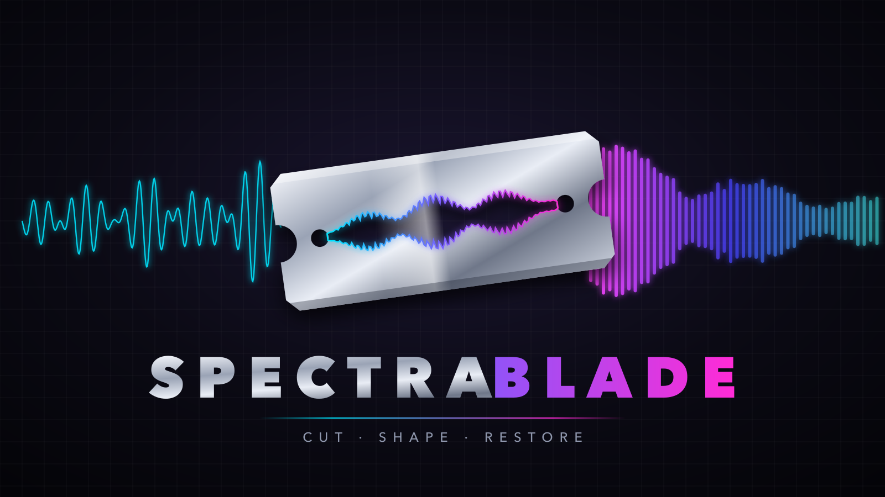
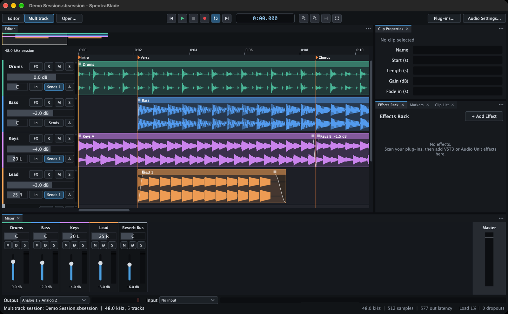
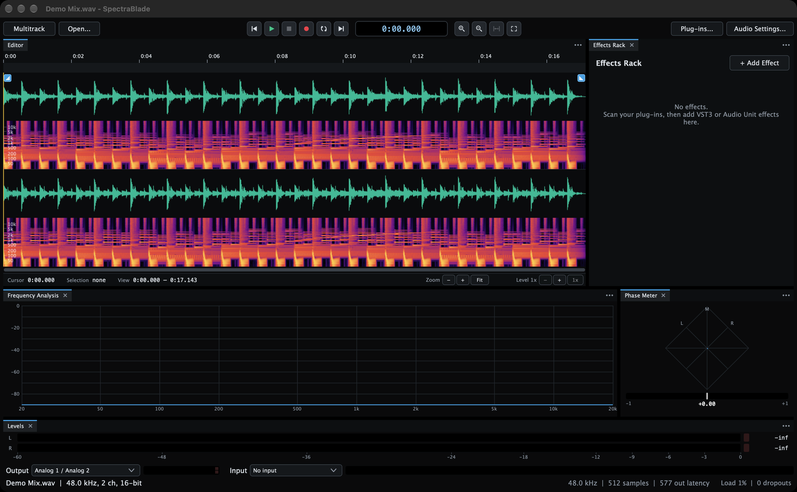
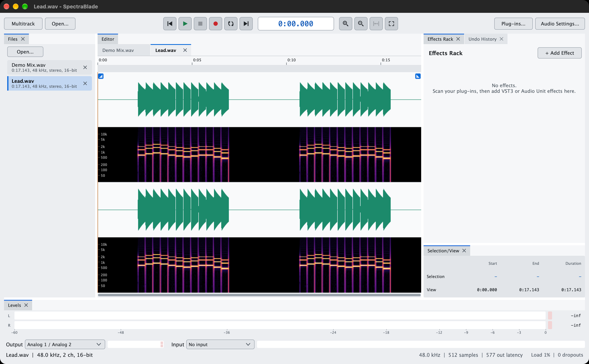
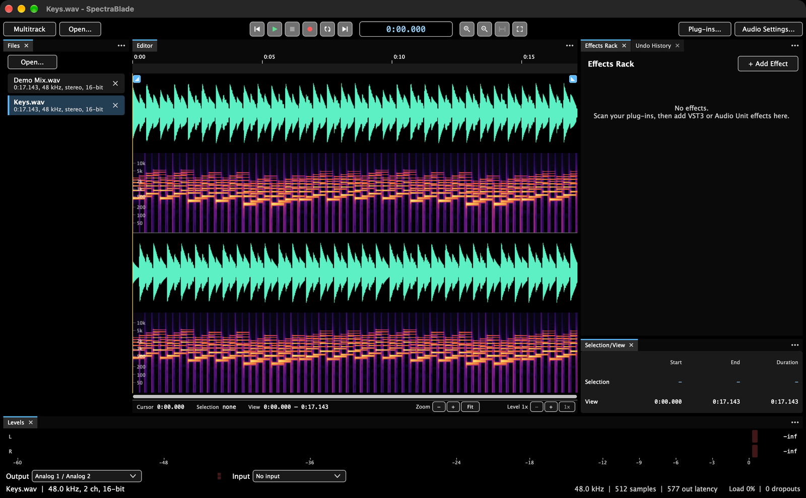

# SpectraBlade

[](https://github.com/BobClawblaw/spectrablade/releases/latest)
[](LICENSE)


[](https://juce.com)

[](https://github.com/BobClawblaw/spectrablade/commits/main)

A clean-room audio editor for macOS: waveform and spectral editing, repair and loudness tools, built-in effects, multitrack sessions with automation and mixdown, and VST3 and Audio Unit plug-ins. Built on JUCE 9.0.4.



**[Download the latest release](https://github.com/BobClawblaw/spectrablade/releases/latest)** (macOS 13 or later, Apple silicon). Newer pre-releases, made for trying out on the way to 1.0, are on the [Releases](https://github.com/BobClawblaw/spectrablade/releases) page.

**Status:** 0.14.10, a pre-release for dogfooding: feature work has stopped, and the releases from here to 1.0.0 fix what real use turns up. See the [changelog](CHANGELOG.md) for what each version holds, the [dogfooding log](docs/DOGFOODING.md) for what use has found and what fixed it, the [roadmap](ROADMAP.md) for what comes next, and [keyboard shortcuts](docs/SHORTCUTS.md) for the keys.

## Features

- **Editing audio files:** waveform and spectrogram views; cut, copy, paste, paste mix and paste to fill; silence, insert and trim silence, crop, reverse, invert, swap, copy or silence one channel, mix to mono and make stereo; gain, normalize (each channel or each region on its own), fades with shapes (or dragged straight from handles on the waveform, curve and all), gain and pan ramps, balance and stereo width; removing what is panned to the centre of a stereo mix, or keeping it alone; lining up channels a time offset apart (automatic phase correction); stretching and pitch shifting a selection or the whole file, and an extreme stretch (up to a thousand times) that smears a sound into a pad, keeping its pitch and colour and losing its timing; pitch correction of a voice or solo line, to a scale or by dragging its notes in the Pitch Editor, in pitch or in time (where notes can also be split and joined), in a file or a session clip; markers and regions, with lists, CSV import and export, and saving regions or the pieces between markers as files; file info (title, artist and so on, and broadcast-wave details); an undo history.
- **Repair and analysis:** spectral selection (box, lasso and brush) and attenuation, healing a drawn spot from the sound around it, noise reduction, reverb reduction, click and pop repair, hum removal (50 or 60 Hz and its harmonics), clipped-peak repair, tone, sweep, noise and telephone signalling (DTMF and MF) generators, Repair Selection, DC offset removal, a noise gate; finding clipping, silences and sounds; an Amplitude Statistics panel (peaks and where they are, true peaks, samples at full scale, DC offset, RMS of the whole and of the loudest and quietest 50 ms windows with a histogram of them, the bits the samples need, and loudness, per channel, copied as text); EBU R128 loudness with Match Loudness, Meet Delivery Spec (EBU R128, ATSC A/85, an online target or a custom spec in one step, with a report, also for mixdowns and stems), a speech leveller and true-peak limiting; stereo correlation; sample-rate conversion.
- **Sound Library:** a window of its own (Window > Sound Library, or F5 to show and hide it) for a large sound-effects library: the folders you choose (and only those) indexed in the background, searched by the words of names and descriptions, sorted, browsed by folder or by UCS category (from UCS file names or iXML, or set by hand), rated, marked as favourites and tagged (categories and tags written into WAV files' iXML when asked, safely), listed by format (the Formats menu above the list leaves out, say, the AIFF twins of your WAVs; the choice is kept, and is on the Settings window's Sound Library page too), inserted at the cursor with Return, previewed (the whole waveform, a moving playhead, scrubbing, looping) and dragged into the multitrack view, the editor, the Finder or other apps, whole or just a part selected in the preview.
- **Effects:** parametric EQ (each band on every channel, the mid or the side, or the left or the right; minimum or linear phase), dynamic EQ (bands with the same channels), graphic (10 and 31 bands), single-band and match EQ (a captured reference's tone taken onto the sound), compressor, multiband compressor, de-esser, multiband stereo width, exciter, transient shaper (the five band-split effects in minimum or linear phase), limiter, maximizer, chorus, flanger, phaser, tremolo, echo, reverb and convolution reverb, each applied to the selection with a preview and presets, and most of them also live in the effects rack and on tracks; the effects that can't run live (Noise Reduction, Adaptive Noise Reduction, Dialogue Isolation, Click and Pop Repair, Mouth De-click, De-crackle, De-plosive, Breath Control, Wind, Rustle and Bleed, Wow and Flutter, Spectral Recovery, Rebalance, Ambience Match, Reduce Reverb, Remove Hum, Repair Clipping, Stretch, Shift Pitch, Pitch Correction, Dialogue Contour, Level Speech, Centre Channel, Phase Correction, Azimuth, Gain, Normalize, Normalize Each Region, Match Loudness, Meet Delivery Spec, Dither, Codec Preview, Balance, Stereo Width, the gain and pan ramps, the fades, Crossfade Loop, Noise Gate, Attenuate Frequencies, Echo, Tremolo, EQ Band) previewed too, processed in the background: the selection's first 30 s, or all of it for those whose result depends on all of it (Normalize, Normalize Each Region, Match Loudness, Meet Delivery Spec, the ramps, the fades, Crossfade Loop, Attenuate Frequencies, Phase Correction, Repair Clipping keeping the peak level); every effect dialog with sliders the mouse wheel and arrow keys step, Space to start and stop the preview (on from the start when the file was playing as the dialog opened), Bypass to compare, and presets, among them 201 factory presets for common jobs (dialogue cleanup, vocals, mastering to a loudness target, vinyl repair and more) to start from; VST3 and Audio Unit plug-ins, each checked when it is scanned. Stretch and Shift Pitch have two methods: Signalsmith Stretch, and SpectraBlade Stretch, our own phase vocoder, which plays each attack at its own speed so drum hits and plucked notes keep their edge.
- **Recording:** from the cursor, or punched in over a selection with pre-roll and post-roll; loop recording into takes; several tracks at once; input monitoring through a track's effects; a metronome and count-in.
- **Multitrack sessions:** tracks, buses, sends, track and bus outputs into buses or out of other outputs of the audio interface, ducking under a voice, sidechain inputs on plug-ins (a key track into a compressor), folders and groups; clip gain, fades, crossfades, stretching (by Option-dragging a clip's edge, too) and pitch shifting; automation of volume, pan, the surround pan and effect parameters, drawn or written while playing; a tempo map with bars and beats and quantizing; a mixer; scrubbing the mix, effects and all, by dragging along the time ruler; freezing, bouncing, mixdown and stems; recovery after a crash.
- **Getting around:** several files open at once with a Files panel; panels docked around the editor, tabbed or floating, kept in workspaces; a levels meter, a frequency analyzer and a phase meter of what plays; a transport bar whose tooltips show your keys, keyboard shortcuts you can search, change, export and import (with an Audition-style key set), recent files, and files opened from Finder; a strip under the editor with the selection tools (Box, Lasso and Brush, the one in hand lit, and Heal), the cursor, selection and view times and the zoom controls; vertical zoom to see quiet audio; times shown as minutes and seconds, decimal seconds, samples or SMPTE timecode at 24, 25, 29.97 (drop or non-drop) or 30 fps, your choice for the whole app.
- **Themes:** nine of them: Dark, Darker, Slate (cool blue-grey), Charcoal (neutral grey), Midnight (deep navy), Light, Paper (warm off-white), Fog (cool grey-blue) and High Contrast, each with a Blue, Teal, Orange or Violet accent and a choice of waveform colour, switched at once from View > Theme and kept for next time.

## File formats

| Format | Open | Write |
|---|---|---|
| WAV (RF64 too) | Yes, with markers and regions | Save: 8, 16 or 24-bit (dithered) or 32-bit float, with markers and regions |
| AIFF | Yes, with markers and tags | Save: 8, 16 or 24-bit (dithered), with markers and tags |
| FLAC | Yes, with tags | Save: 16 or 24-bit (dithered), with tags |
| MP3 | Yes | File > Export as MP3 or AAC: constant 96 to 320 kbps, or variable V0, V2 or V4 (LAME) |
| AAC (.m4a) | Yes | File > Export as MP3 or AAC: 96 to 320 kbps average (the macOS encoder) |
| Apple Lossless (.m4a), CAF and the other types macOS reads | Yes | Apple Lossless through ffmpeg |
| Ogg Vorbis | Yes | No |
| Opus | Yes, with tags | File > Export with ffmpeg |
| WavPack, AC-3 | Through ffmpeg | File > Export with ffmpeg |
| WMA, E-AC-3, Monkey's Audio, TTA, MKA, MP2, AMR, DTS | Through ffmpeg | No |
| The sound of a video (MP4, M4V, MOV, MKV, WebM, AVI) | Through ffmpeg: its first audio stream | No |

File > File Info shows and changes the title, artist, album, genre, year, track and comment, a front cover (a JPEG or PNG image of up to 8 MB: Choose Image... or Remove), and the broadcast-wave (BWF) details. WAV keeps all of them; AIFF (an ID3 chunk), FLAC (Vorbis comments and a picture block), MP3 (ID3v2) and AAC (.m4a) keep the tags and the cover, and the ffmpeg exports the tags. They are read from WAV, AIFF, MP3, MPEG-4, FLAC, Ogg Vorbis and Opus files (the Ogg files' covers aside).

MP3 and AAC files hold one or two channels at up to 48 kHz; audio above 48 kHz is written at 44.1 or 48 kHz. Both keep the audio's exact length and start, through the encoder-delay information players read.

The formats marked "through ffmpeg" need [ffmpeg](https://ffmpeg.org) installed (with Homebrew, `brew install ffmpeg`); SpectraBlade looks for it in `/opt/homebrew/bin`, `/usr/local/bin`, `/opt/local/bin` and the `PATH`. It is not part of SpectraBlade. A file opened through ffmpeg is decoded in full to 32-bit float; saving it again goes through Save As.

Opening a video edits its sound and shows its picture in the Video panel (Window > Video), following the cursor and playing along; File > Attach Video... gives any file a video to go with. File > Save Sound into Video... writes a copy of the video with the edited sound (needs ffmpeg). macOS shows MP4, M4V and MOV pictures (and some AVI) itself; for MKV, WebM and others it can't show, ffmpeg makes a preview (kept in ~/Library/Caches/SpectraBlade/Video Previews), labelled "preview" in the panel. The picture follows edits that change the sound's length: a cut jumps it, audio pasted from elsewhere in the file brings its picture, and inserted silence or generated audio shows black. With the length unchanged, the picture is copied into the new video as it is; with it changed, the picture is cut to match and encoded again (H.264, or VP9 in WebM, MPEG-4 in AVI).

A multitrack session can have a video too: in the Multitrack workspace, File > Attach Video... gives the session one, and File > Video Start... sets where in the session its first frame plays (typed, or at the cursor). The Video panel then follows the session's playhead, black before the video starts. File > Save Mix into Video... writes a copy of the video with the session's mix from that start for the video's length, its picture copied as it is (needs ffmpeg). The video and its start are kept in the session file, and so in projects. To bring a video's own sound into the session, import the video as you would an audio file.

Files with more than two channels open and edit like any other, with each lane named (L R C LFE Ls Rs for 5.1, L R C LFE Lrs Rrs Lss Rss for 7.1). Transport > Play Surround Folded Down plays 5.1 and 7.1 folded down to stereo (centre and surrounds at -3 dB, LFE left out); Play Surround to Separate Outputs plays L and R on the output pair and the other channels on the outputs after it, one each (up to 8 channels), all through the effects rack: its built-in compressor and limiter hear every channel at once, and other effects run on each pair. Make Stereo folds 5.1 or 7.1 down for good, File > Save Channels as Mono Files... splits a file into one WAV per channel, and File > New File from Mono Files... puts files back together as one (six named ... L, R, C, LFE, Ls, Rs go in 5.1 order, eight named ... L, R, C, LFE, Lrs, Rrs, Lss, Rss in 7.1 order); a 7.1 WAV is saved with its speakers marked. A session mixes in stereo, or in 5.1 or 7.1 with Multitrack > 5.1 Master or 7.1 Master: each track and bus is then placed with the surround pad on its mixer strip (with a width and an LFE share), a 5.1 track (right-click its header) plays 5.1 clips straight to the speakers, through its effects as three stereo pairs, with the built-in compressor and limiter linking all six (and freezes to six channels), the master plays folded down or to separate outputs as a 5.1 or 7.1 file does (through the effects rack on every pair), and a mixdown writes six or eight channels. In a 7.1 master a 5.1 track's surrounds play from the side surrounds. A 7.1 track does for 7.1 clips what a 5.1 track does (its effects as four pairs, the compressor and limiter linking all eight); in a 5.1 master its rear and side surrounds both go to Ls and Rs at -3 dB.

Effects > Record Sequence records the effects you apply, with their settings, until you stop it and give the sequence a name. Effects > Play Sequence... plays one on the selection, or the whole file, as one step to undo, and Batch Process can play one on every file. Gain, Normalize, Match Loudness, the channel commands, Balance, Stereo Width, Echo, Tremolo, EQ Band, Compressor, Limiter, De-esser, Chorus, Flanger, Phaser, Reverb, Reduce Reverb, Level Speech, Centre Channel, Automatic Phase Correction, Stretch, Extreme Stretch, Shift Pitch, Pitch Correction, Convert Sample Rate and Apply Effects Rack are recorded; stopping lists any other edits made meanwhile, which aren't.

File > Batch Process... puts many files through the same steps and writes each as a new file, leaving the originals as they are. Choose files or folders (their folders are searched too), then the steps, run in this order: the effects rack, a recorded sequence, a sample rate, mono or stereo, the level (the peak, or the loudness in LUFS under a true-peak ceiling, stopping short or limiting to reach it), and the file type with its bit depth or bit rate. The new files go beside each source or into a chosen folder, named after the source with any suffix you give, and numbered when the name is taken. Markers, tags and the cover go along where the type keeps them, and a report lists what happened to each file.

## Screenshots


The Editing workspace: two files open in the Files panel on the left (click one to work on it; Window > File Tabs adds tabs over the editor), the effects rack, undo history and selection panel on the right, and the levels meter below. The small handles at the waveform's top corners drag fades in and out; the strip under the waveform shows the cursor, selection and view and holds the zoom controls.



A multitrack session in the Multitrack workspace: four tracks and a reverb bus with clips, clip fades, a crossfade, sends and markers, the mixer underneath, and clip properties, the rack, markers and the clip list as tabs on the right.



The Analysis workspace, in the Darker theme: a frequency analyzer and a phase meter of what plays, under the editor.

| Light | High Contrast |
|---|---|
|  |  |

The Light and High Contrast themes (View > Theme).

The audio in all of them was generated for the screenshots.

## Download and install

The newest build marked for everyone is at [Releases > Latest](https://github.com/BobClawblaw/spectrablade/releases/latest); pre-releases (newer, for trying out) and every other build are on the [Releases](https://github.com/BobClawblaw/spectrablade/releases) page, as `SpectraBlade-<version>.dmg`, with a `.sha256` beside each. They are built for Apple silicon and need macOS 13 or later. There is no Intel build (releases up to 0.14.0 were universal, but their Intel half was never tried).

Open `SpectraBlade-<version>.dmg` and drag SpectraBlade to Applications; the licence is beside it as `LICENSE.txt`. The app is signed ad hoc, not with a Developer ID, so macOS blocks it the first time: open it once, then choose Open Anyway under System Settings > Privacy & Security. After that it opens normally. macOS asks for microphone access the first time you choose a recording input.

Then choose Window > Plug-ins... and Scan for Plug-ins. The first scan of a large collection takes a while; it runs in the background, and the window shows how far it has got.

## Getting started

- **Open a file:** File > Open (Cmd-O), drop it on the window, or click one of the recent files listed in the empty editor. Tick Preview in the open panel to hear files as you select them.
- **Start a file:** File > New File (Cmd-N) makes a file of silence at a chosen sample rate (the interface's to start with), channels (mono, stereo, 5.1 or 7.1), bit depth and length (0.1 to 3,600 s), to record, paste or generate into. It opens beside the files open, named Untitled until Save As.
- **Look at it:** View > Waveform (Cmd-1), Spectrogram (Cmd-2), or Waveform and Spectrogram (Cmd-3); in the last, drag the line between the two to size them.
- **Zoom:** the strip under the editor has zoom out, in and Fit, and the vertical zoom ("Level 1x") with its own buttons: zoom in vertically (Option-Cmd-=, or Option-scroll) to see quiet audio, up to 64x, with the level the lane's edges stand for shown at its top left. The same strip shows the cursor, selection and view times; click the cursor's for Go to Time, the selection's for Set Selection.
- **Fade in and out:** drag the small handle at the waveform's top-left corner to the right for a fade in, or the one at the top-right to the left for a fade out; drag up or down as you go to bend the curve. Drag again to adjust it while it is still the last edit; double-click a handle to remove its fade.
- **Edit:** select by dragging (double-click selects the whole file), Option-drag in the spectrogram to select a band of frequencies (or, with the lasso or brush tool, chosen from the strip under the editor or with D and P, draw round or paint over just the sound to edit: the lasso follows the mouse freehand, showing the line so far and a faint dotted edge back to its start, and closes along that edge when you let go; Shift adds to the drawing and Option takes from it, the brush is as strong as you set it, Command-Z takes back the last stroke while you draw, then Delete removes what is inside the drawing, keeping the file's length, or Heal it away; either way the drawing is done with and goes, leaving the time selection), and use the Edit and Effects menus. With a plain selection, Delete takes its time out of the file. Space plays the selection (with a box, lasso or brush selection in the spectrogram, only what is inside it), or from the cursor. Shift and an arrow key move the selection's end that way by a pixel's worth of time, Command-Shift and an arrow its start, and Edit > Select at Zero Crossings lands every end you drag or nudge on a zero crossing. The playhead and the transport's time show the frame being heard: an effect with latency in the rack or a live preview (the linear-phase EQ and band splits, the convolution reverb) puts them that much behind the player, and playback runs on past the end of the file or selection until the last of it has come through. To find a place by ear, drag along the ruler above the waveform while stopped: the sound under the mouse plays as it moves, faster or backwards as you drag, and the cursor stays where you let go.
- **Use plug-ins on a file:** add effects to the effects rack beside the editor (+ Add Effect, by format and maker; a new effect's window opens in front at once), set them up while you listen (Edit brings a window back), then Effects > Apply Effects Rack (Cmd-R) writes them into the selection or the whole file. Window > Effects Rack (Option-Cmd-E) hides or shows it.
- **Multitrack:** the Editor | Multitrack switch at the top left (or View > Multitrack Session, Cmd-4) moves between the file and the session, lit on the side in use, and the status line under the editor starts with "Editing file" or "Multitrack session"; each track's FX button holds its own effects.
- **Projects:** File > Save Project keeps everything open to come back to with File > Open Project...: the files with where you were in each, the effects rack and its settings, and the multitrack session if there is one. Files with unsaved changes are written as copies into a "<project> Files" folder beside the project (the files you opened are left alone), so keep that folder with the project. Each file's undo history is kept too (its audio in "<project> Files/History"), so undo and redo carry on after reopening; that can take a lot of room, and File > Keep Undo History in Projects turns it off.
- **Several files:** files you open join the ones already open; choose several at once in File > Open, or drop several on the editor. Each has a tab over the editor (and Window > Files lists them); click one to show it (each keeps its own selection, zoom and undo history), and Cmd-W closes the one showing. File > Next File and Previous File step through them.
- **Meters and analysis:** Window > Levels meters what goes to the outputs (click it to reset the peaks and clip lights); Window > Frequency Analysis and Phase Meter show its spectrum and its stereo image; Window > Tonal Balance shows its long-term spectrum against a target range for a style of material; Window > Amplitude Statistics measures the selection (or the whole file, or a selected clip in a session) when you click Scan: peaks and where they are, true peaks, samples at full scale, DC offset, RMS of the whole and of its loudest and quietest 50 ms windows with a histogram of them, the bits the samples need, and loudness, with Copy for the table as text.
- **Settings:** File > Settings (Cmd-,; also under the application menu) gathers every setting of the app in one window, sections down the left: Look (theme, accent, waveform colour, time format, what the editor shows), Editing, Playback, Multitrack, Recording (pre-roll, post-roll, count-in, metronome, input monitoring, loop recording), Audio (the interface), Plug-ins, Keys and the Sound Library. Each change takes effect at once, and the menus' own switches stay in step with it.
- **Panels and workspaces:** the effects rack, the selection, the files, the mixer, markers, clip lists, the meters and the rest are panels docked around the editor. Drag a panel's tab onto the edge of another panel to dock it there, onto its middle to make it a tab there, or out of the window to float it; drag the bars between panels to size them. Close a panel with its ×, and show it again from the Window menu. The ⋯ at the right of a group's tabs opens its menu; Maximize there, or double-clicking a tab, shows that group alone, filling the window, and Window > Maximize Editor (Shift-Cmd-F) does it for the editor; do it again to bring the others back. Window > Workspace switches between layouts (Classic, Editing, Multitrack, Analysis and your own), keeps each as you left it, saves the current one under a name, and puts one back as it was saved. Other windows open where you last left them.
- **Time format:** View > Time Format shows every time (the rulers, the transport, the strip under the editor, the marker and clip lists, the dialogs that take a time) as minutes and seconds, decimal seconds, samples, or SMPTE timecode at 24, 25, 29.97 drop, 29.97 or 30 fps; the rulers mark whole samples or frames of timecode to suit, and a time you type is read in that format too (a whole number is samples when Samples is on; hh:mm:ss:ff when a timecode is), with seconds and m:ss still read in any of them. CSV exports and the Sound Library stay in seconds.
- **Themes:** View > Theme picks one of the dark themes (Dark, Darker, Slate, Charcoal, Midnight), the light ones (Light, Paper, Fog) or High Contrast, under Accent the colour that marks what is selected or on, and under Waveform the waveform's colour (the theme's own, Green, Blue, Amber, Rose or Grey). The interface changes at once, and the choice is kept for next time.
- **Keys:** [docs/SHORTCUTS.md](docs/SHORTCUTS.md) lists the keys it ships with. Window > Keyboard Shortcuts... lists every command's keys; change them, export and import them, or pick Key Sets... > Audition-Style Keys.

## Plug-ins

SpectraBlade hosts VST3 and Audio Unit (v2 and v3) effects. Window > Plug-ins... scans for them **out of process**: each one is loaded in a worker copy of the app, and one that crashes, or hangs longer than 60 s, is marked as not working while the editor keeps running.

- AU: `/Library/Audio/Plug-Ins/Components`, `~/Library/Audio/Plug-Ins/Components`, and AUv3 app extensions
- VST3: `/Library/Audio/Plug-Ins/VST3`, `~/Library/Audio/Plug-Ins/VST3`

VST2 is deliberately not supported: Steinberg no longer licenses the VST2 SDK.

## Building from source

You need Xcode (command-line tools) and CMake 3.22 or later.

```bash
cmake -S . -B build -DCMAKE_BUILD_TYPE=Release
cmake --build build -j 12
open build/SpectraBlade_artefacts/Release/SpectraBlade.app
```

CMake fetches JUCE 9.0.4, LAME 4.0 (checked against its SHA-256) and Signalsmith Stretch 1.4.0 with Signalsmith Linear 0.6.4 (each at its release commit) by itself. To use a local copy instead, add `-DSPECTRABLADE_JUCE_DIR=/path/to/JUCE`, `-DSPECTRABLADE_LAME_DIR=/path/to/lame-4.0`, `-DSPECTRABLADE_STRETCH_DIR=/path/to/signalsmith-stretch` or `-DSPECTRABLADE_LINEAR_DIR=/path/to/signalsmith-linear`.

## Packaging

```bash
Scripts/package.sh
```

This builds a Release app for Apple silicon (arm64 only) in `build-release/`, signs it ad hoc, runs the integration tests with that signed app as the plug-in scan worker, and writes `dist/SpectraBlade-<version>.dmg` (the app, `LICENSE.txt`, LAME's licence as `LAME-LICENSE.txt`, and Signalsmith Stretch's and Signalsmith Linear's as `SIGNALSMITH-STRETCH-LICENSE.txt` and `SIGNALSMITH-LINEAR-LICENSE.txt`) with its SHA-256. Options: `--juce <dir>` builds with a local JUCE checkout, `--jobs <n>` sets the build's parallel jobs (4 by default), and `--skip-tests` skips the tests. The version comes from `CMakeLists.txt`.

To check a disk image's app on its own, mount it and point the tests at it:

```bash
./build-release/SpectraBladeTests_artefacts/Release/SpectraBladeTests --app "/Volumes/SpectraBlade 0.14.10/SpectraBlade.app/Contents/MacOS/SpectraBlade"
```

## Tests

```bash
./build/SpectraBladeTests_artefacts/Release/SpectraBladeTests
```

They cover editing and undo bit for bit, every effect, file formats, plug-in scanning and hosting, the audio device, recording, the multitrack mixer, automation, mixdown, the interface driven by the mouse and the command table (every command described, in a menu and with a key of its own, checked by a Python script the suite runs); [docs/TESTING.md](docs/TESTING.md) lists what each part checks, and how to run the opt-in plug-in sweep.

## Reporting a problem

Please open an [issue](https://github.com/BobClawblaw/spectrablade/issues) with the version (SpectraBlade > About SpectraBlade), what you did, what happened and what you expected, and the kind of file if one was involved. The app keeps a log at `~/Library/Logs/SpectraBlade/SpectraBlade.log`: the audio device it opened, plug-in scans, every error it showed, and, if it crashed, the stack it crashed on. Attach it, and the matching report from `~/Library/Logs/DiagnosticReports` after a crash.

## Licence

SpectraBlade is licensed under the GNU Affero General Public License, version 3; the full text is in `LICENSE`. JUCE is dual-licensed under the AGPLv3 or a commercial JUCE licence, and SpectraBlade uses it under the AGPLv3. The Sound Library's categories are the Universal Category System's list, v8.2.1 (universalcategorysystem.com, a public domain initiative), converted by `Scripts/ucs_convert.py` into `ThirdParty/UCS/`. The MP3 encoder is LAME 4.0's library (LGPL 2 or later), fetched from its pinned source release and built into the app. Signalsmith Stretch (one of the two methods of Stretch and Shift Pitch, and the one stretching clips uses) is version 1.4.0, with the Signalsmith Linear 0.6.4 FFTs (both MIT licence, Signalsmith Audio), fetched at their release commits and built into the app. Anyone who passes on the app, changed or not, must offer its source code under the same licence.

`Scripts/package.sh` signs the app ad hoc, without the hardened runtime, so it loads any plug-in's code. Releases are not signed with a Developer ID and are not notarized, so Gatekeeper asks the first time the app is opened (see [Download and install](#download-and-install)). The CMake target still asks for the hardened runtime with `disable-library-validation` (which third-party plug-ins need), which takes effect for anyone who builds and signs it with their own Developer ID.

## Clean-room rules

This codebase is written from functional specs and public documentation only:
- Never decompile, disassemble or inspect another editor's binaries or bundles.
- Never copy its names, icons, UI layout, help text or factory presets.
